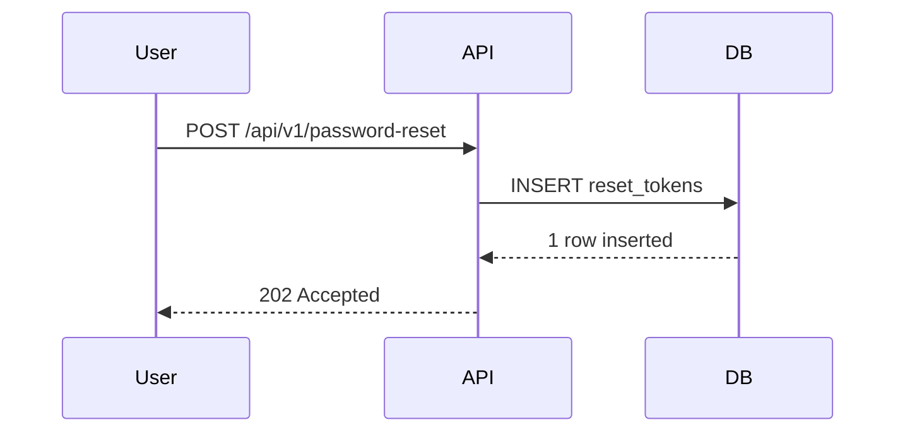

# Sequence Walkthrough

Turn a Mermaid sequence diagram into a guided, step-by-step walkthrough of how a project really works. Each arrow gets a plain-language card that says which API is called, what is sent, what comes back and why. Chapters get their own colour, every request links to its replies, the hooks and crons behind a step sit one click away, and an AI of your choice answers follow-up questions in under 60 words.

The project has two parts:

| Part | What it is |
|---|---|
| **Viewer** | A static web page, also available as one self-contained file. No server, no account, no install. Paste Mermaid code and walk through it. |
| **`seq-diagram` and `detailed-seq-diagram` skills** | Two Claude skills that write these diagrams from your source code, in five modes: explain, proposed design, scoped cut, easy wording and compact. The fast one answers in about a minute; the detailed one gives every hop, payload and code link, checked by a bundled validator. |

The diagrams are plain Mermaid. The walkthrough text lives in `%%` comments (format `walkthrough/2`), so the same code still renders unchanged on GitHub, mermaid.live and anywhere else Mermaid runs.

---

## Contents

- [Run the viewer](#run-the-viewer)
- [Use the viewer](#use-the-viewer)
- [Ask AI](#ask-ai)
- [The annotation format](#the-annotation-format)
- [The Claude skill](#the-claude-skill)
- [Make it live and share it](#make-it-live-and-share-it)
- [Project structure](#project-structure)
- [Development](#development)
- [Privacy and dependencies](#privacy-and-dependencies)

---

## Run the viewer

You need **Node 24 or later** (`.nvmrc` has the version).

```bash
npm ci
npm run build
```

This writes the website to `apps/web/dist/` and the one-file viewer to `apps/web/dist-single/`:

```text
apps/web/dist/index.html                            the website: the viewer, with its code in assets/
apps/web/dist/sequence-walkthrough-skill-kit.zip    both skills, their setup guide and the installer
apps/web/dist/sequence-walkthrough-one-file.zip     the two pages below, as one download
apps/web/dist-single/sequence-walkthrough.html      the whole viewer in one file (about 7 MB)
apps/web/dist-single/sequence-viewer.html           the same page, only for publishing as a Claude artifact
```

Then either:

- **Open the file:** double-click `apps/web/dist-single/sequence-walkthrough.html`. It works straight from disk.
- **Or serve the website locally:** this matches how it runs once it's online.

  ```bash
  npm run preview -w @swv/web
  ```

  Then open the address it prints.

No build needed for the one-file viewer: download [`sequence-walkthrough-one-file.zip`](https://rudra-tank-albetrios.github.io/sequence-walkthrough/sequence-walkthrough-one-file.zip) from the live site and unzip it.

Everything is bundled, so the viewer needs no CDN and works with no internet connection. Only Ask AI goes online, and only to the provider you choose.

---

## Use the viewer

New here? Click **How it works** in the header (on a phone: **⋯ → How it works**). It explains the viewer and how to set up and use the skill in a few key points, and has a button to download the skill.

1. Paste Mermaid `sequenceDiagram` code into the code panel. Open it with the **Code** button or **C**; the tab on the panel's right edge closes it. You can also use **Export → Paste a link or code…**, or **Open a file…** (`.mmd`, `.md`, `.txt`).
2. Press **→**, or roll the mouse wheel over the step bar, to go through the flow one arrow at a time. Each step shows its card, highlights the arrow and moves the camera to it.
3. Hover any arrow for its summary: the explanation, the status code's meaning, the payload parts, the side parts, chips and code references, in a translucent tooltip. Click the arrow for the full card.
4. Drag the top edge of the step bar to change its height (double-click the edge to reset). Fold the header or the step bar away with the small tabs on the screen edges; the same tab brings each part back.

### What a card shows

- **The call and its reply.** The label of a request is its method and path (`POST /api/v1/payments`); the label of a reply starts with its status code and message. A request card lists every reply it can get, one chip per `alt` branch, with the step to jump to. A reply card links back to its request, shows the general meaning of the status code, and lists which fields were added or changed compared with the request body.
- **What is sent.** Payload parts as labelled boxes: Headers, Query, Path params, Cookies, Body, SQL, Event, Input, Result.
- **Why.** The `@step` text, with glossary words underlined. Click one for its definition.
- **The chapter.** A coloured chip with the step's position in the chapter and the chapter's one-line summary on its first step.
- **Data detail.** Schema rules per field, state before and after a write, where a returned value came from, effects such as an email or a metric, and chips for async, retry, timeout and idempotent behaviour.
- **Also involved.** An expandable strip with the hooks, crons, utilities, config and env values that take part in this step without being a layer, each with its code reference.
- **Code reference** chips, an orange **unconfirmed** chip for anything the skill could not settle from the code, and a **proposed** chip when the whole flow is a design.
- Your **bookmark**, **note** and **Ask AI** buttons.

### Chapters

Each `@section` chapter gets a fixed pastel colour. The current chapter is drawn as a light band behind its arrows, with a "▶ start" and "■ end" marker, while the other chapters fade a little, so you always see where the chapter begins, where it ends and where you are in it. The same colour marks the chapter tab, the progress bar under it, the code gutter and the table rows. **Chapter band** in the canvas controls turns the band off. **K** locks the arrow keys inside the current chapter.

### Paths, side parts and the Insight panel

- **Path** (in the step bar, when the flow has branches): walk every step, the happy path only, the errors only, or one `alt` branch. Steps outside the chosen path fade in the diagram, disappear from the table, and the arrow keys skip them.
- **Behind** (in the step bar): the hooks, crons, utilities, config and side effects of the whole flow, grouped by kind and expandable, each with the steps it acts in.
- **Insight** (**I**): a side panel with six tabs. *Layers* with their kind, description, steps, chapters, files and side parts; *Endpoints*, every call with its replies; *Errors*, every 4xx and 5xx reply with its message, branch and cause, plus the unconfirmed details; *Behind the scenes*; *Glossary*, the `@term` lines plus the answers you saved from Ask AI, editable; *Data*, the tables touched and the files in the flow.
- The overview card (press **Esc** or **Home**) shows what starts the flow, its scope, the possible endings with their status codes, and the layers with their icons. Layers with a `kind=` also get dotted trust-boundary lines in the diagram between the client, our systems and external services.

### Keys

| Key | Action |
|---|---|
| `←` `→` | Previous / next step (skips steps hidden by the path filter) |
| `Home` `End` | First / last step |
| `[` `]` | Previous / next chapter |
| `K` | Lock the arrow keys inside the current chapter |
| `Space` | Play / pause |
| `+` `−` / `Ctrl` + wheel | Zoom |
| `0` / `F` | Fit width / fit all |
| `T` | Switch between diagram and table |
| `I` | Insight panel |
| `A` | Ask AI about the current step |
| `H` | Hide the controls |
| `P` | Presenter mode: controls hidden, one big card, your note as speaker notes |
| `C` | Open / close the code panel |
| `B` / `N` | Bookmark / note on the current step |
| `/` | Find |
| `?` | All shortcuts |
| Wheel over the step bar | Previous / next step |
| Drag the step bar's top edge | Change its height |
| Hover an arrow | Its summary; click it for the full card |
| Double-click a word | Follow that value through the flow |
| Click an underlined word | Its definition |
| Click a participant | Show only that participant's arrows |

### Export menu

- PDF (multi-page, with the participant header repeated on each page)
- PNG at 1×, 2× or 4×
- SVG, a step image, the `.mmd` code, and a CSV or Markdown step table (with status, side parts, effects and unconfirmed columns; the Markdown adds the glossary and the side parts)
- A mermaid.live link, a viewer link with the diagram inside the URL, and a link that opens on the current step
- Ask AI provider and key
- **Download the skill**

Exported files are named after the diagram's `@title`.

---

## Ask AI

Press **A** on any step, or select a word and right-click it, to ask a short question: "Explain simpler", "Why this step?", "What if it fails?", "What is tombstone?" or anything you type. Two modes:

- **In this project** sends the step's label, explanation, payload, the two layer descriptions and the relevant glossary lines, so the answer is about this step.
- **In general** sends only the question.

Answers are under 60 words, written for a developer new to the codebase, in plain words with technical terms glossed. Every answer is saved into the step's note (press **N** to edit it later), and a "What is …?" answer can be added to the glossary with one click.

The viewer is a static page, so it cannot hide an API key. You pick the provider under **Export → Ask AI → Provider and key…** and the key stays in this browser's storage; it is sent only to that provider.

| Provider | Needs | Notes |
|---|---|---|
| Groq, Google Gemini, OpenRouter, Cerebras, Mistral | a free API key from the provider | Check the provider's current free tier before relying on it. The model name can be changed. |
| Ollama on this computer | Ollama running locally, no key | Start it with `OLLAMA_ORIGINS=*` so the page may call it. |
| Custom OpenAI-compatible endpoint | a URL, optionally a key | For your own proxy: a small Netlify Function or Cloudflare Worker that holds one key for a group of friends. |
| Claude | nothing, but only when the page is opened as a Claude artifact | Uses the artifact's `sample` capability; the viewer asks for consent on the first question. |

If a provider refuses browser requests, the panel says so; pick another provider or put a proxy in front of it.

---

## The annotation format

Format `walkthrough/2` (version 1 files still work). Every annotation is a Mermaid comment. Flow-level tags sit in a header block; step-level tags sit directly above the arrow they describe:



| Tag | Level | Meaning |
|---|---|---|
| `@spec` | flow | Format version, `walkthrough/2` |
| `@title` | flow | Flow name, used for the header and export file names |
| `@mode proposed` | flow | The flow is a design that does not exist in the code yet |
| `@scope <text>` | flow | Where a cut of a bigger flow starts and ends |
| `@trigger <text>` | flow | What starts the flow |
| `@term <word>: <definition>` | flow | A glossary entry; the word is underlined on every card |
| `@layer <alias> kind=<kind> <text>` | flow | What a participant is and does; kinds: person, client, edge, middleware, service, worker, db, cache, queue, external |
| `@section <name>` | chapter | Starts a chapter |
| `@summary <text>` | chapter | One line on what the chapter settles |
| `@step <text>` | step | The card for the next arrow (required on every arrow) |
| `@payload.<part> <text>` | step | What the arrow carries: headers, query, params, cookies, body, sql, event, input, result (plain `@payload` still works) |
| `@ref <path:line>` | step | Where the step happens in the code |
| `@uses <kind> <name> [path:line] <text>` | step | A side part: hook, cron, listener, job, worker, util, config, env, cache, flag, migration, test, lib. Middleware is never a side part; it is always a layer. |
| `@effect <text>` | step | A side effect that is not an arrow |
| `@field <name> <text>` | step | Where a returned value came from |
| `@schema <field> <text>` | step | A validation rule and the error it produces |
| `@state before` / `@state after` | step | What is true in the store before and after a write |
| `@async` `@retry` `@timeout` `@idempotent` | step | Chips, with a short text |
| `@unconfirmed <text>` | step | A detail that could not be confirmed from the code |

The full specification, including what the viewer derives from the arrows (request-reply pairs, endings, happy path, data touched) and every lint code, is in [skills/shared/references/annotation-spec.md](skills/shared/references/annotation-spec.md). The viewer checks the annotations as you type: the code panel lists any arrow without a `@step`, empty chapters, malformed tags and similar problems. **Copy fix-prompt** turns that list into a request you can paste straight to Claude.

---

## The Claude skills

Two skills write these diagrams from a project's code, in the `walkthrough/2` format the viewer reads:

| Skill | What you get | Say |
|---|---|---|
| **`seq-diagram`** | The everyday flow, in about a minute: every layer the flow crosses, numbered arrows, statuses and messages, field names, a code link on calls and client replies. | "diagram this flow", "how does X work", "walk me through the checkout", "explain only the part after the service layer", "how would I build X here", "in easy language" |
| **`detailed-seq-diagram`** | Every hop and every return, full payloads with example values, error bodies, schemas, state changes and a code link on every step, checked with the bundled validator. Slower, and more tokens. | "detailed seq diagram", "detailed flow", "full detail" |

Both put the code in the chat in one `mermaid` block (a `.md` file only over about 50 KB, never an artifact), draw middleware as its own layer, keep every layer in Easy mode, and link only code they really opened.

### Get them

- In the viewer: **Export → Skill for Claude → Download the skill**. This saves `sequence-walkthrough-skill-kit.zip`.
- Or after `npm run build`: `apps/web/dist/sequence-walkthrough-skill-kit.zip`.
- From source: `npm run build:skills` writes `tools/build-skills/dist/` with `seq-diagram/`, `detailed-seq-diagram/`, one zip per skill, `install.mjs`, the [setup guide](skills/shared/kit/SKILL-SETUP-GUIDE.md) and `sequence-walkthrough-skill-kit.zip`, which holds all of it.
- The sources are in `skills/`: rules both skills share in `skills/shared/`, each skill's own text in `skills/<name>/SKILL.src.md`. The validator lives in `packages/core` and is bundled into each skill's `scripts/validate.mjs` (Node only, no packages).

### Install them

**Claude Code** (terminal, desktop app, IDE): `npm run install:skills`, or `node install.mjs` from the unzipped kit. It copies both skills into `~/.claude/skills`, moves anything it replaces and the old `sequence-walkthrough` and `detailed-seqflow` skills to `~/.claude/skill-backups`, and can be run again. Start a new session afterwards. For one project only, copy the two folders to `<project>/.claude/skills/` instead.

**Claude app** (claude.ai, desktop, mobile):
1. Open **Settings → Capabilities** and turn on **Code execution and file creation**.
2. Open **Customize → Skills**, click **+**, then **Create skill → Upload a skill**, and upload `seq-diagram.zip`, then `detailed-seq-diagram.zip`. Remove the older `sequence-walkthrough` or `detailed-seqflow` if it is there.

**Claude Agent SDK.** Put the two folders in `<project>/.claude/skills/` and load filesystem skills with `settingSources: ["user", "project"]` and `skills: ["seq-diagram", "detailed-seq-diagram"]`.

**Claude API.** Upload each zip once with `client.skills.create(files=[open("seq-diagram.zip", "rb")])`, then pass `container={"skills": [{"type": "custom", "skill_id": "<id>", "version": "latest"}]}` together with the code execution tool.

The [setup guide](skills/shared/kit/SKILL-SETUP-GUIDE.md) has the full steps for each of these, plus updating and troubleshooting.

### Use it

Ask in plain words, or in Claude Code call one by name. Both skills pick the mode from your words:

| You say | Mode | What you get |
|---|---|---|
| "Diagram the checkout flow in ./src/checkout", "explain how login works" | **Explain** | The flow as the code is today: every middleware, query, external call, event and response. |
| "I want to add a receipt email, how would it be done here, give me the flow" | **Proposed** | A design marked `@mode proposed` that reuses the project's real layers, middleware chain, naming, response envelope and error format. Existing steps keep real code links; new steps point at the code they should follow. |
| "Only the email sending after the service layer" | **Scoped** | The flow starts exactly at that boundary, says where it is entered from, and draws nothing outside the asked part. |
| "Explain it in easy language", "beginner friendly" | **Easy** | The same layers and the same arrows, with the explanations in everyday words and a glossary line for every technical word. Layers are never removed or merged unless you ask for fewer or combined layers. |
| "Fewer steps", "combine the layers" | **Compact** | Routes through Repository folded into one Backend participant. Only when you ask for it. |

```text
/seq-diagram diagram the checkout flow in ./src/checkout
```

```text
Explain the order checkout flow in easy language.
```

```text
Show only the part after OrderService.create(): how the confirmation email is sent.
```

```text
Check this diagram and add the missing @step lines: <paste the Mermaid code>
```

What you get back:
- **The code only, in the reply.** Claude doesn't create any file, unless you ask for one and say where.
- **The real API detail.** Each request shows the method and full path, each reply the status code and message, with payload parts for what is sent and returned, every error branch, the hooks and crons behind each step, a glossary, chapter summaries and code links.
- **Taken from your project, then verified.** Every endpoint, field, status code and message comes from the code. Before replying Claude re-opens every referenced line and confirms it; anything it could not confirm is marked `@unconfirmed` on the step or listed under *Not confirmed*. The reply ends with `Verified: N of N refs re-opened, M unconfirmed`.
- **Middleware as a main layer**, always, in every mode.
- **Fewer tokens.** The skill reads only the files on the code path, once, and answers with the code block and two check lines, no prose.

A typical loop:
1. Paste the code from Claude's reply into the viewer.
2. If the code panel shows warnings, **Copy fix-prompt**, paste it back to Claude, and paste the answer into the viewer.

Notes you took in the viewer stay attached to steps whose arrows didn't change.

The validator also runs on its own, on a file or on stdin:

```bash
npm run build:skills
node tools/build-skills/dist/seq-diagram/scripts/validate.mjs my-flow.mmd
```

Use `-` instead of a file name to read the code from stdin. Add `--json` for machine-readable output or `--strict` to fail on style hints. It exits with 0 when clean, 1 on errors or warnings, and 2 when a file can't be read.

---

## Make it live and share it

The viewer is a static website, so any static host can serve it for free. Pick one of the options below. Each gives you a public `https://` link to send to anyone: your friends just open it, and nothing gets installed.

### Option 1: Netlify Drop (fastest, no Git)

1. Run `npm ci`, then `npm run build`.
2. Go to <https://app.netlify.com/drop>.
3. Drag the **`apps/web/dist`** folder onto the page. It holds `index.html` at its top, which Netlify needs.
4. Netlify gives you a link like `https://<random-name>.netlify.app`. Sign up for a free account to keep the site online, since an unclaimed drop is removed after a while. Then pick a nicer name in the site's settings.

To update the site, rebuild and drag the folder again on the site's **Deploys** page.

### Option 2: GitHub Pages (free, updates on every push)

The workflow is already included in [.github/workflows/deploy-pages.yml](.github/workflows/deploy-pages.yml). This repository lives at `github.com/rudra-tank-albetrios/sequence-walkthrough`; Pages on a free plan needs the repository to be public.

1. On GitHub, open **Settings → Pages**, and under **Build and deployment** set **Source** to **GitHub Actions**.
2. Open the **Actions** tab and wait for **Deploy to GitHub Pages** to finish (about a minute). If it ran before step 1, choose **Run workflow**.
3. Your link is `https://<you>.github.io/sequence-walkthrough/`.

Every push to `main` rebuilds and redeploys the site.

### Option 3: Netlify, Cloudflare Pages or Vercel connected to Git

Connect the repository and use these settings. Netlify reads them from [netlify.toml](netlify.toml) automatically.

| Setting | Value |
|---|---|
| Build command | `npm run build` |
| Output / publish directory | `apps/web/dist` |
| Framework preset | None / Other |

### Option 4: The Claude artifact link

`sequence-viewer.html` (in `apps/web/dist-single/` after a build, or in `sequence-walkthrough-one-file.zip`) is the same page, built to publish as a Claude artifact. Open the artifact, then use its **Share** menu to choose who can view it. Files viewers save from it go through Claude's own save dialog. To let viewers use the Claude provider in Ask AI, publish the artifact with the `sample` capability declared (and `downloads` for the export menu).

### Before you share

- Anyone with the link can open the site, from anywhere, with no account. A new link isn't listed anywhere, but search engines can find and index it once it appears on a public page. To keep it out of search results, add `<meta name="robots" content="noindex">` to `apps/web/index.html`.
- On GitHub Pages' free plan the repository is public, so anyone can also see the source code.
- Each friend's notes, bookmarks, saved terms, settings and AI keys stay in their own browser. Nothing is uploaded or shared between visitors.
- To send someone a specific diagram, use **Export → Copy viewer link**, or **Copy link to this step** to open on a step. The diagram code travels inside the link, so they see exactly what you see.
- If you make the repository public, add a `LICENSE` file so others know how they may use the code.
- To use your own domain, every host above supports one under its domain settings. Point a `CNAME` record at the host.

---

## Project structure

```text
.
├── apps/web/                   the viewer: React, TypeScript and Vite
├── packages/core/              the walkthrough/2 parser, the flow model and the validator
├── examples/demo-store/        the small real project behind the demo flow
├── e2e/                        browser tests and the live-site smoke test
├── docs/                       architecture, decisions, the build plan and feature parity
├── skills/
│   ├── shared/                 rules both skills share, their references, the kit's setup guide
│   ├── seq-diagram/            SKILL.src.md of the fast skill
│   ├── detailed-seq-diagram/   SKILL.src.md of the detailed skill, and its examples
│   └── fixtures/               sample projects (Express, NestJS, Next.js, Django, feature folders) the skills are tested against
├── tools/build-skills/         builds both skills, their zips, the installer and the kit into tools/build-skills/dist/
├── tools/                      also the size budgets and the demo's code-link check
├── FEATURE-IDEAS.md            the feature list this version was built from, with what is still open
├── .github/workflows/          GitHub Pages deployment
├── netlify.toml                Netlify build settings
└── apps/web/dist, dist-single/ build output, not committed: the website and the one-file viewer
```

---

## Development

> **Version 3 is being built.** The plan is in [`docs/IMPLEMENTATION-PLAN.md`](docs/IMPLEMENTATION-PLAN.md), the layout in [`docs/ARCHITECTURE.md`](docs/ARCHITECTURE.md), and the setup in [`CONTRIBUTING.md`](CONTRIBUTING.md): `npm ci`, then `npm run check` before a merge (`npm run verify` is the full run by hand).

- Edit files in `apps/web/src` with `npm run dev` running. `npm run build` writes the website and the one-file viewer, which inlines the scripts, styles and fonts and embeds the skill kit.
- The build is reproducible: the same sources always give the same bytes, including the zips.
- **To change the default diagram,** edit `examples/demo-store/flows/place-order.mmd`. Keep its arrow lines unchanged if you want existing notes to stay attached.
- **To add a tag,** update `skills/shared/references/annotation-spec.md` first, then the parser in `packages/core`, the card in `apps/web/src/features/walkthrough`, and `packages/core/src/validate.ts` so the viewer and the validator agree on codes and messages.
- **The skills** live in `skills/`: rules both share in `skills/shared`, each skill's own text in `skills/<name>/SKILL.src.md`. `npm run build:skills` writes both folders, their zips and the kit to `tools/build-skills/dist/`, and stops if a skill breaks a rule. `npm run install:skills` installs them for Claude Code and backs up what it replaces.
- Mermaid is pinned to **12.2.0** and jsPDF to **4.2.1** through `apps/web/package.json` and the lockfile. The viewer's line numbers, highlighting and chapter bands depend on Mermaid's SVG structure, so test a diagram with steps, chapters, notes and exports before you change the version.

---

## Privacy and dependencies

- **No server, no analytics, no cookies.** Diagrams, notes, bookmarks, saved glossary terms and AI settings never leave the browser; they are kept in `localStorage`.
- **Ask AI** sends your question, and in project mode the current step's text, to the provider you chose, with the key you entered. Nothing is sent until you ask.
- **Nothing loads from a CDN:** Mermaid and jsPDF are bundled with the viewer, and on the website jsPDF loads only when you export a PDF.
- **Fonts:** Recursive (SIL Open Font License) is built into the page, so exports keep their typography.
- **Browsers:** tested in Microsoft Edge (Chromium) on desktop and at phone width. Current Chrome, Firefox and Safari should work, but they weren't part of the test runs.
