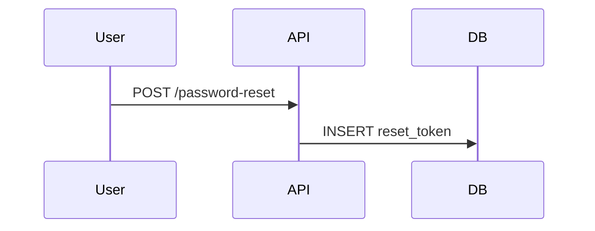

# Sequence Walkthrough

Turn a Mermaid sequence diagram into a guided, step-by-step walkthrough. Each arrow gets a plain-language card that says what moves between the layers and why. Step through it with the arrow keys, follow a value through the whole flow, take notes, and export the diagram as PDF, PNG, SVG or a step table.

The project has two parts:

| Part | What it is |
|---|---|
| **Viewer** | One self-contained web page (`index.html`). There's no server, no account and no install. Paste Mermaid code and walk through it. |
| **`sequence-walkthrough` skill** | A Claude skill that writes these diagrams for you from source code, an API spec, logs or a plain description. It also checks and fixes existing ones. |

The diagrams are plain Mermaid. The walkthrough text lives in `%%` comments, so the same code still renders unchanged on GitHub, mermaid.live and anywhere else Mermaid runs.

---

## Contents

- [Run the viewer](#run-the-viewer)
- [Use the viewer](#use-the-viewer)
- [The annotation format](#the-annotation-format)
- [The Claude skill](#the-claude-skill)
- [Make it live and share it](#make-it-live-and-share-it)
- [Project structure](#project-structure)
- [Development](#development)
- [Privacy and dependencies](#privacy-and-dependencies)

---

## Run the viewer

You need **Python 3.8 or later**. Nothing else gets installed: the build uses only the standard library.

```bash
python build.py
```

This writes the website to `dist/`:

```text
dist/index.html                          the viewer (one file, about 450 KB)
dist/sequence-walkthrough.zip            the skill, ready to upload to Claude
dist/sequence-walkthrough-skill-kit.zip  the skill, its setup guide and install scripts
```

It also writes `dist-claude/sequence-viewer.html`, which is only for publishing the page as a Claude artifact.

Then either:

- **Open the file:** double-click `dist/index.html`. It works straight from disk.
- **Or serve it locally:** this matches how it runs once it's online.

  ```bash
  python -m http.server 8766 --directory dist
  ```

  Then open <http://localhost:8766>.

The page loads Mermaid from a CDN, so the first open needs an internet connection.

---

## Use the viewer

New here? Click **How it works** in the header (on a phone: **⋯ → How it works**). It explains the viewer and how to set up and use the skill in a few key points, and has a button to download the skill.

1. Paste Mermaid `sequenceDiagram` code into the code panel. Open it with **C** or the tab on the left edge. You can also use **Export → Paste a link or code…**, or **Open a file…** (`.mmd`, `.md`, `.txt`).
2. Press **→** to go through the flow one arrow at a time. Each step shows its card, highlights the arrow and moves the camera to it.
3. Fold the header, step bar or code panel away with the small tabs on the screen edges. The same tab brings each part back.

| Key | Action |
|---|---|
| `←` `→` | Previous / next step |
| `Home` `End` | First / last step |
| `[` `]` | Previous / next chapter |
| `Space` | Play / pause |
| `+` `−` / `Ctrl` + wheel | Zoom |
| `0` / `F` | Fit width / fit all |
| `T` | Switch between diagram and table |
| `H` | Hide the controls |
| `C` | Open / close the code panel |
| `B` / `N` | Bookmark / note on the current step |
| `/` | Find |
| `?` | All shortcuts |
| Double-click a word | Follow that value through the flow |
| Click a participant | Show only that participant's arrows |

**Export menu:**
- PDF (multi-page, with the participant header repeated on each page)
- PNG at 1×, 2× or 4×
- SVG, a step image, the `.mmd` code, and a CSV or Markdown step table
- A mermaid.live link, and a viewer link with the diagram inside the URL
- **Download the skill**

Exported files are named after the diagram's `@title`.

---

## The annotation format

Format `walkthrough/1`. Every annotation is a Mermaid comment that sits directly above the arrow it describes:



| Tag | Meaning |
|---|---|
| `@spec` | Format version, `walkthrough/1` |
| `@title` | Flow name, used for the header and export file names |
| `@layer <alias> <text>` | What a participant is and does |
| `@section <name>` | Starts a chapter |
| `@step <text>` | The card for the next arrow (required on every arrow) |
| `@payload <json or text>` | An example request or message body |
| `@ref <path:line>` | Where the step happens in the code |

The full specification is in [skill/sequence-walkthrough/references/annotation-spec.md](skill/sequence-walkthrough/references/annotation-spec.md). The viewer checks the annotations as you type: the code panel lists any arrow without a `@step`, empty chapters and similar problems. **Copy fix-prompt** turns that list into a request you can paste straight to Claude.

---

## The Claude skill

The skill is called **`sequence-walkthrough`**. It teaches Claude to write diagrams in this format, check them with a bundled validator, and fix them from the viewer's fix-prompt.

### Get it

- In the viewer: **Export → Skill for Claude → Download the skill**. This saves `sequence-walkthrough-skill-kit.zip`.
- Or after `python build.py`: `dist/sequence-walkthrough-skill-kit.zip`, or `dist/sequence-walkthrough.zip` for the skill alone.
- Or from source: the folder [skill/sequence-walkthrough/](skill/sequence-walkthrough/).

The kit holds the upload zip, the skill folder, [SKILL-SETUP-GUIDE.md](skill-kit/SKILL-SETUP-GUIDE.md) and install scripts for Windows and macOS/Linux.

### Install it

**Claude Code** (terminal, desktop app, IDE). Copy the folder into your personal skills folder, then start a new session:

```powershell
# Windows, from the unzipped kit
powershell -ExecutionPolicy Bypass -File .\install-claude-code.ps1
```

```bash
# macOS / Linux, from the unzipped kit
sh ./install-claude-code.sh
```

To install it for one project only, and share it with your team through Git, copy the folder to `<project>/.claude/skills/sequence-walkthrough/` instead.

**Claude app** (claude.ai, desktop, mobile):
1. Open **Settings → Capabilities** and turn on **Code execution and file creation**.
2. Open **Customize → Skills**, click **+**, then **Create skill → Upload a skill**, and pick `sequence-walkthrough.zip`. Upload the zip itself, not the whole kit.
3. Make sure `sequence-walkthrough` is switched on. To update it later, delete the old one there and upload the new zip.

**Claude Agent SDK.** Put the folder in `<project>/.claude/skills/` and load filesystem skills:

```typescript
import { query } from "@anthropic-ai/claude-agent-sdk";

for await (const message of query({
  prompt: "Make a walkthrough diagram of the payment flow in ./src",
  options: {
    settingSources: ["user", "project"],
    skills: ["sequence-walkthrough"],
    allowedTools: ["Read", "Grep", "Glob", "Bash"],
  },
})) {
  if (message.type === "result" && message.subtype === "success") console.log(message.result);
}
```

**Claude API.** Upload once with `client.skills.create(files=[open("sequence-walkthrough.zip", "rb")])`, then pass `container={"skills": [{"type": "custom", "skill_id": "<id>", "version": "latest"}]}` together with the code execution tool.

The [setup guide](skill-kit/SKILL-SETUP-GUIDE.md) has the full steps for each of these, in Python and TypeScript, plus Managed Agents, updating and troubleshooting.

### Use it

Ask in plain words, or in Claude Code call it by name:

```text
/sequence-walkthrough diagram the checkout flow in ./src/checkout
```

```text
Make a walkthrough diagram of how login and token refresh work in this repo, with code links.
```

```text
Write a sequence walkthrough for this webhook handler: <paste code>
```

```text
Explain the order checkout flow in easy language.
```

```text
Check this diagram and add the missing @step lines: <paste the Mermaid code>
```

What you get back:
- **The code only, in the reply.** Claude checks it with `scripts/validate.py` through stdin and doesn't create any file, unless you ask for one and say where.
- **The real API detail.** Each request arrow shows the method and full path, such as `POST /api/v1/orders`. Each reply shows the status code and message, such as `201 Created` or `401 Unauthorized "Invalid email or password"`. The `@payload` lines show the headers and body sent and returned.
- **Taken from your project.** Every endpoint, field, status code and message comes from the code, with an `@ref` to the line. Anything Claude couldn't confirm is listed under *Not confirmed* instead of drawn.
- **Two levels.**
  - **Full**, the default: every hop, middleware and error response.
  - **Easy**, when you say "in easy language", "simply" or "high level": only the important steps, in everyday words. The calls, status codes and refs stay exact.

A typical loop:
1. Paste the code from Claude's reply into the viewer.
2. If the code panel shows warnings, **Copy fix-prompt**, paste it back to Claude, and paste the answer into the viewer.

Notes you took in the viewer stay attached to steps whose arrows didn't change.

The validator also runs on its own, on a file or on stdin:

```bash
python skill/sequence-walkthrough/scripts/validate.py my-flow.mmd
```

Use `-` instead of a file name to read the code from stdin. Add `--json` for machine-readable output or `--strict` to fail on style hints. It exits with 0 when clean, 1 on errors or warnings, and 2 when a file can't be read.

---

## Make it live and share it

The viewer is one static page, so any static host can serve it for free. Pick one of the options below. Each gives you a public `https://` link to send to anyone: your friends just open it, and nothing gets installed.

### Option 1: Netlify Drop (fastest, no Git)

1. Run `python build.py`.
2. Go to <https://app.netlify.com/drop>.
3. Drag the **`dist`** folder onto the page. It holds `index.html` at its top, which Netlify needs.
4. Netlify gives you a link like `https://<random-name>.netlify.app`. Sign up for a free account to keep the site online, since an unclaimed drop is removed after a while. Then pick a nicer name in the site's settings.

To update the site, rebuild and drag the folder again on the site's **Deploys** page.

### Option 2: GitHub Pages (free, updates on every push)

The workflow is already included in [.github/workflows/deploy-pages.yml](.github/workflows/deploy-pages.yml).

1. Create a repository on GitHub. Make it public, because Pages on a private repository needs a paid plan. Then push this project to it:

   ```bash
   git init
   git add .
   git commit -m "Sequence Walkthrough viewer and skill"
   git branch -M main
   git remote add origin https://github.com/<you>/sequence-walkthrough.git
   git push -u origin main
   ```

2. On GitHub, open **Settings → Pages**, and under **Build and deployment** set **Source** to **GitHub Actions**.
3. Open the **Actions** tab and wait for **Deploy to GitHub Pages** to finish (about a minute). If it ran before step 2, choose **Run workflow**.
4. Your link is `https://<you>.github.io/sequence-walkthrough/`.

Every push to `main` rebuilds and redeploys the site.

### Option 3: Netlify, Cloudflare Pages or Vercel connected to Git

Connect the repository and use these settings. Netlify reads them from [netlify.toml](netlify.toml) automatically.

| Setting | Value |
|---|---|
| Build command | `python3 build.py` |
| Output / publish directory | `dist` |
| Framework preset | None / Other |

### Option 4: The Claude artifact link

`dist-claude/sequence-viewer.html` is the same page, built to publish as a Claude artifact. Open the artifact, then use its **Share** menu to choose who can view it. Files viewers save from it go through Claude's own save dialog.

### Before you share

- Anyone with the link can open the site, from anywhere, with no account. A new link isn't listed anywhere, but search engines can find and index it once it appears on a public page. To keep it out of search results, add `<meta name="robots" content="noindex">` to `SITE_META` in `build.py`.
- On GitHub Pages' free plan the repository is public, so anyone can also see the source code.
- Each friend's notes, bookmarks and settings stay in their own browser. Nothing is uploaded or shared between visitors.
- To send someone a specific diagram, use **Export → Copy viewer link**. The diagram code travels inside the link, so they see exactly what you see.
- If you make the repository public, add a `LICENSE` file so others know how they may use the code.
- To use your own domain, every host above supports one under its domain settings. Point a `CNAME` record at the host.

---

## Project structure

```text
.
├── build.py                    builds dist/ from src/ and skill/
├── src/
│   ├── body.html               page markup
│   ├── style.css               all styles (light and dark themes)
│   ├── js/                     core, render, walk, views, export, shell (joined in this order)
│   └── fonts/                  Recursive font files, built into the page
├── skill/
│   └── sequence-walkthrough/   the Claude skill
│       ├── SKILL.md
│       ├── references/         annotation spec, writing guide, layer naming
│       ├── examples/           payment-idempotency.mmd (the viewer's default diagram), oauth-login.mmd
│       └── scripts/validate.py
├── skill-kit/                  setup guide and install scripts packed into the skill download
├── .github/workflows/          GitHub Pages deployment
├── netlify.toml                Netlify build settings
├── dist/                       build output, not committed: the website, deploy this folder as it is
└── dist-claude/                build output, not committed: the page for publishing as a Claude artifact
```

---

## Development

- Edit files in `src/`, then run `python build.py` and reload the page. The build joins the JavaScript files in order, inlines the CSS and fonts, and embeds the default diagram and the skill kit.
- The build is reproducible: the same sources always give the same bytes, including the zips.
- **To change the default diagram,** edit `skill/sequence-walkthrough/examples/payment-idempotency.mmd`.
- **To change the skill,** edit `skill/sequence-walkthrough/`, rebuild so the download in the viewer picks it up, then reinstall it wherever you use it. For the Claude app and the API, upload the new `sequence-walkthrough.zip`.
- Mermaid is pinned to **12.2.0** and jsPDF to **4.2.1** in `src/js/core.js` (`VERSION` and the CDN URL list). The viewer's line numbers and highlighting depend on Mermaid's SVG structure, so test a diagram with steps, chapters, notes and exports before you change the version.

---

## Privacy and dependencies

- **No server, no analytics, no cookies.** Diagrams, notes and bookmarks never leave the browser. Notes and settings are kept in `localStorage`.
- **Loaded at runtime:** Mermaid 12.2.0 from jsDelivr, falling back to unpkg, and jsPDF 4.2.1, loaded only when you export a PDF.
- **Fonts:** Recursive (SIL Open Font License) is built into the page, so exports keep their typography.
- **Browsers:** tested in Microsoft Edge (Chromium) on desktop and at phone width. Current Chrome, Firefox and Safari should work, but they weren't part of the test runs.
