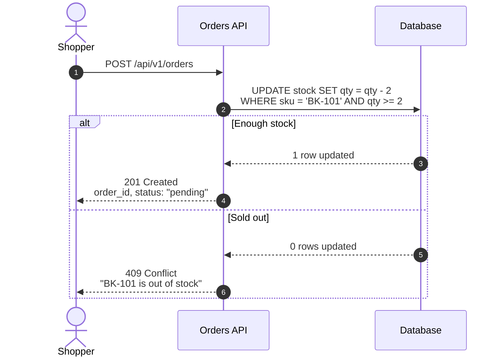

# Annotation spec `walkthrough/2`

Version 2 · 2026-10-30 · read by the Sequence Walkthrough Viewer v2 and `validate.py`. Version 1 files still work unchanged: every v1 tag keeps its meaning, v2 only adds tags.

Walkthrough annotations turn a Mermaid sequence diagram into a guided, step-by-step explanation. Every annotation is a Mermaid comment (`%% …`), so annotated code still renders unchanged on mermaid.live, GitHub, GitLab, Notion and any other Mermaid renderer. Only the viewer gives the comments meaning.

## Contents

1. Shape of a file
2. Tags
3. Rules
4. How steps are identified
5. What the viewer derives from the arrows
6. Lint
7. Mermaid syntax traps
8. Fallbacks
9. Complete example

## 1. Shape of a file

```
sequenceDiagram                              ← diagram type (front matter and %% comments may come first)
    %% @spec walkthrough/2                   ← header block: spec, title, mode, trigger, terms, one @layer per participant
    %% @title <flow name>
    %% @mode proposed                        ← only for a flow that does not exist yet (design mode)
    %% @scope <where the flow starts and ends>   ← only for a flow cut out of a bigger one
    %% @trigger <what starts the flow>
    %% @term <word>: <short definition>
    %% @layer <alias> kind=<kind> <description>
    autonumber                               ← optional, recommended
    actor U as User                          ← participants, in left-to-right order
    participant API as Orders API

    %% @section <chapter name>               ← optional chapters
    %% @summary <one line on the chapter>    ← optional, right after @section
    %% @step <what happens and why>          ← annotations for the next arrow
    %% @payload.headers <headers sent>
    %% @payload.body <body sent>
    %% @ref <path:line or URL>
    %% @uses <kind> <name> [path:line] <what it does here>
    %% @effect <side effect that is not an arrow>
    U->>API: POST /api/v1/orders             ← the arrow they belong to
```

Indentation is free. Blank lines are ignored.

## 2. Tags

### Flow level (header block)

| Tag | Value | Shown in the viewer as |
|---|---|---|
| `%% @spec walkthrough/2` | format version | not shown; marks the file |
| `%% @title <text>` | the flow's name | top-left name, file names of every export |
| `%% @mode proposed` | the flow is a design, not existing code | "Proposed" badge next to the title; every card says the step does not exist yet |
| `%% @scope <text>` | where this cut of a bigger flow starts and ends | first line of the overview card |
| `%% @trigger <text>` | what starts the flow: a click, a cron, a webhook, another flow | "Starts when" line on the overview card |
| `%% @term <word>: <definition>` | a glossary entry, one per line | the word is underlined on every card; hover or click shows the definition; Glossary tab in the Insight panel |
| `%% @layer <alias> [kind=<kind>] <text>` | what the layer is and does in this flow; `kind` is optional | tooltip on the participant, Layers tab, icon per kind, trust-boundary lines between zones |

Layer kinds: `person`, `client`, `edge`, `middleware`, `service`, `worker`, `db`, `cache`, `queue`, `external`. Zones for the boundary lines: `person` and `client` are the client zone; `edge`, `middleware`, `service`, `worker`, `db`, `cache` and `queue` are our zone; `external` is outside.

### Chapter level

| Tag | Where | Shown as |
|---|---|---|
| `%% @section <name>` | above the first arrow of a chapter | chapter tab with its own colour, chapter band behind its arrows, segment of the progress bar |
| `%% @summary <text>` | right after `@section`, before its first arrow | summary line on the chapter's first card and in the chapter tab's tooltip |

### Step level (attach to the next arrow)

| Tag | Value | Shown as |
|---|---|---|
| `%% @step <text>` | what happens and why, 1–2 sentences, under 240 characters | the card's explanation, the table's "Does" column |
| `%% @payload <text>` | example data on this arrow (v1 form, still valid) | "Payload" box on the card |
| `%% @payload.<part> <text>` | one part of the data: `headers`, `query`, `params`, `cookies`, `body`, `sql`, `event`, `input`, `result` | one labelled box per part: "Headers", "Body", "SQL" … |
| `%% @ref <path:line or URL>` | where the step lives in the code | source chip on the card, table "Ref" column |
| `%% @uses <kind> <name> [path:line] <text>` | a side part that runs at this step but is not a layer | "Also involved" strip under the card, "Behind the scenes" list for the whole flow |
| `%% @effect <text>` | something that happens because of this step and is not an arrow: an email, a metric, a log line, a cache cleared | "Effects" chips on the card |
| `%% @field <name> <text>` | where a value in this arrow came from, e.g. `order_id from step 6` | "Fields" list on the card; "step N" becomes a link |
| `%% @schema <field> <text>` | a validation rule for one field: type, required, format, limits, and the error it produces | "Schema" table on the card |
| `%% @state before <text>` / `%% @state after <text>` | what is true in the store or session before and after the step | two-column "State" box on the card |
| `%% @async [text]` | the hop is asynchronous (queue, fire-and-forget) | "async" chip |
| `%% @retry <text>` | retry policy, e.g. `3× with backoff 1s, 2s, 4s` | "retry" chip |
| `%% @timeout <text>` | timeout, e.g. `5 s` | "timeout" chip |
| `%% @idempotent [text]` | the call is safe to repeat | "idempotent" chip |
| `%% @unconfirmed <text>` | a detail of this step that could not be confirmed from the code | orange "unconfirmed" chip with the text |

`@uses` kinds: `hook`, `cron`, `listener`, `job`, `worker`, `util`, `config`, `env`, `cache`, `flag`, `migration`, `test`, `lib`. **Middleware is never a side part.** Middleware that runs on the path is a participant with its own `@layer … kind=middleware`, at every level of detail.

Tag names are case-insensitive (`@Step` works), but lower case is the convention.

## 3. Rules

1. **One annotation per line**, starting with `%% @` after optional indentation. `%%@step` and `%%   @step` also work.
2. **Step-level tags attach to the next arrow**, even if a block keyword (`alt`, `else`, `loop`, `opt`, `par`, `rect`, `end`), a `Note`, `activate` or a participant line sits between them and the arrow.
3. **Several lines of the same tag are joined.** `@step` lines are joined with a space; `@payload`, `@payload.<part>`, `@state before`, `@state after` and `@summary` lines with a line break; `@ref`, `@uses`, `@effect`, `@field`, `@schema`, `@unconfirmed` and `@term` each add one entry.
4. **`@section` starts a chapter at the next arrow** and applies to every arrow until the next `@section`. Arrows before the first `@section` belong to an unnamed opening chapter, shown as **Start**. `@summary` belongs to the most recent `@section`; before any `@section` it describes the whole flow and shows on the overview card.
5. **Flow-level tags can be anywhere**, but belong in the header block. If `@title`, `@spec`, `@mode`, `@scope` or `@trigger` appears twice, the last one wins. `@term` and `@layer` add one entry each; a repeated word or alias replaces the earlier entry.
6. **`@uses` grammar:** the first word is the kind, the second the name. If the third word looks like `path:line` or a URL it is the reference. Everything after is the description. `%% @uses hook useCart src/hooks/useCart.ts:12 Keeps the cart id in sessionStorage.`
7. **`@term` grammar:** the word or phrase, then `:`, then the definition. Without a colon, the first word is the term. Definitions are one sentence in everyday words.
8. **`@layer` grammar:** the alias, then an optional `kind=<kind>`, then the description.
9. **Never write `%%{`.** Mermaid reserves `%%{ … }%%` for configuration. It is not an annotation.
10. **Plain comments are fine.** A `%%` line without `@` is ignored by the viewer.
11. **Notes, bookmarks and saved AI answers are never stored in the code.** They are personal and stay in the viewer.

### Title precedence

The flow name is the first of: `@title`, the front-matter `title:`, Mermaid's `title` keyword, and finally "Sequence diagram". File names use the flow name with `\ / : * ? " < > |` removed, so `@title Payment idempotency` exports as `Payment idempotency.pdf`, `Payment idempotency.mmd` and so on.

## 4. How steps are identified

Steps are numbered in drawing order, the same order as Mermaid's `autonumber`. Personal notes, bookmarks and saved AI answers are matched to a step by **sender → receiver | label**, plus an occurrence count when the same arrow appears twice. As a result:

- editing any annotation text never detaches a note;
- adding or removing other arrows never detaches a note (unless the added arrow is an exact copy of an existing one);
- changing an arrow's sender, receiver or label moves its notes to **Notes for changed steps**, where they can be re-attached.

Tools that update walkthrough code should keep arrow lines unchanged unless asked to change them.

## 5. What the viewer derives from the arrows

These need no tags, but they work best when the code follows the writing guide.

| Derived | How | Write for it |
|---|---|---|
| **Request ↔ reply pairs** | A dashed arrow B → A answers the nearest earlier solid arrow A → B. One request can have several replies, one per `alt` branch. | Every request gets its dashed reply back to the caller. |
| **Reply catalog** | All replies to one request, with the status code read from the start of each label. | Replies start with the status code: `201 Created`, `409 Conflict`. |
| **Status explainer** | The status code's general meaning from a built-in table, next to the card text. | Copy the code and message exactly from the code. |
| **Endings** | The replies to the flow's first request, shown on the overview card. | The first arrow with a method and path is the main request. |
| **Happy path / errors only / one branch** | Steps inside an `else` branch, or whose reply has a 4xx or 5xx status, are the error paths. The first branch of each `alt` is the success path. | Put the success branch first, then the errors in the order the code checks them. |
| **Chapter colours and bands** | Each chapter gets a fixed pastel; the band covers its arrows from the first to the last. | 2–6 chapters of a few steps each. |
| **Payload diff** | When a request body and its reply body both parse as JSON, the reply card lists added, removed and changed fields. | Use the field names exactly as the code defines them. |
| **Data touched** | Tables and columns from `@payload.sql` lines and from labels that contain SQL. | Show the statement with its table and condition. |
| **Trust boundaries** | A dotted line between neighbouring participants in different zones (see layer kinds). | Give every layer a `kind=`. |

## 6. Lint

The viewer lists these in the code panel, and `validate.py` reports them as **warnings** with the same codes, messages and line numbers:

| Code | When | Message |
|---|---|---|
| `no-step` | an arrow has no `@step` above it | Step N (From → To) has no @step |
| `orphan` | a step-level tag with no arrow after it | Annotation has no arrow after it |
| `unknown-alias` | a `@layer` alias is not a participant | @layer X: no participant has this alias |
| `layer-empty` | `@layer` with nothing after it | @layer needs an alias and a description |
| `long-step` | a step's joined `@step` text is over 240 characters | Step N: @step is N characters (keep it under 240) |
| `empty-section` | a `@section` with no arrow before the next `@section` or the end, or with no name | Chapter "X" has no steps |
| `no-title` | no `@title` | Add %% @title <flow name> so the flow has a name |
| `unknown-tag` | `%% @something` that is not a known tag | Unknown tag @x (known: …) |
| `uses-format` | `@uses` without a kind and a name | @uses needs a kind and a name: @uses hook useCart … |
| `term-empty` | `@term` without a definition | @term needs a word and a definition: @term tombstone: … |
| `state-kind` | `@state` not followed by `before` or `after` | @state needs before or after |
| `field-empty` | `@field` without a name and a source | @field needs a name and where it comes from |
| `schema-empty` | `@schema` without a field and a rule | @schema needs a field and its rule |
| `payload-part` | `@payload.<part>` with an unknown part | Unknown payload part "x" (known: headers, query, params, cookies, body, sql, event, input, result) |

The viewer adds `mismatch` when Mermaid draws a different number of arrows than the code lines it found (for example, an arrow hidden inside an unsupported construct).

`validate.py` adds:

| Severity | Code | When |
|---|---|---|
| error | `semicolon`, `no-colon`, `unknown-line`, `block`, `keyword-alias`, `not-sequence` | Mermaid 12 will not parse the code (see section 7) |
| warning | `hash-cut` | a label contains `#`, so Mermaid drops the rest of it |
| warning | `no-arrows` | a sequence diagram with no arrows |
| hint | `spec` | `@spec walkthrough/2` is missing or different (`walkthrough/1` is accepted) |
| hint | `layer-missing` | a participant has no `@layer` |
| hint | `layer-kind` | a `@layer` has an unknown `kind=` |
| hint | `no-sections` | more than 8 steps and no `@section` |
| hint | `many-refs` | a step with more than 2 `@ref` lines |
| hint | `config` | a `%%{ … }%%` line |
| hint | `inline-comment` | `%%` inside a statement line, which Mermaid keeps as label text |
| hint | `request-payload` | a `POST`, `PUT` or `PATCH` request with no payload |
| hint | `no-reply` | an HTTP request (`->>` with a method and path) with no dashed reply back to its caller |
| hint | `reply-status` | a reply to an HTTP request whose label doesn't start with a status code |
| hint | `reply-payload` | a 2xx reply (except 204) to an HTTP request with no payload |
| hint | `step-outcome` | a reply's `@step` names neither the status, its reason phrase nor an outcome word (returns, gets, sees, told, back, answer) |
| hint | `no-ref` | a step with no `@ref`, sent by a layer whose other steps have one (people and external systems are exempt) |
| hint | `uses-kind` | `@uses` with a kind that is not in the list |
| hint | `uses-middleware` | `@uses middleware …`: middleware is a layer, not a side part |
| hint | `uses-ref` | `@uses` without a reference in a flow whose steps have `@ref` lines |
| hint | `mode-value` | `@mode` with a value other than `proposed` |
| hint | `no-trigger` | no `@trigger` in a flow with more than 8 steps |

`validate.py -` reads the code from stdin, so a diagram can be checked without saving it to a file.

## 7. Mermaid syntax traps

These were each checked against Mermaid 12.2.0:

| Write | Mermaid does | Instead |
|---|---|---|
| `A->>B: retry; wait` | parse error: `;` ends the statement | a comma, or `#59;` |
| `A->>B: close issue #42` | draws `close issue`: the rest is dropped | `#35;42`, or `issue 42` |
| `A->>B` (no colon) | parse error | `A->>B: ` (an empty label is fine) |
| `alt` … with no `end` | parse error | close every `alt`, `opt`, `loop`, `par`, `critical`, `break`, `rect` and `box` |
| `else` outside `alt` | parse error | `else` only inside `alt`, `and` only inside `par`, `option` only inside `critical` |
| `participant end` | parse error | never use a keyword as an alias |
| `A->>B: hi %% note` | draws `hi %% note` | put comments on their own line |

`<br/>` splits a label over two lines. Quotes, braces, `<`, `>`, `%` and `:` after the first colon are all safe in labels.

## 8. Fallbacks

| Case | Viewer behaviour |
|---|---|
| Arrow without `@step` | The card shows the label and sender → receiver; lint suggests a `@step` |
| No annotations at all | Works like mermaid.live, plus the walkthrough bar showing labels |
| No `@section` | No chapter row, no bands; everything else is unchanged |
| No `@title` | Flow name "Sequence diagram"; lint suggests adding one |
| No `kind=` on the layers | No icons and no boundary lines; everything else is unchanged |
| `@spec walkthrough/1` | Read exactly as before; v2 tags are still understood |
| Not a sequence diagram | Renders with pan and zoom; walkthrough, sticky header and table switch off, with a one-line notice |
| `@spec` missing or different | Read as `walkthrough/2` |

## 9. Complete example


