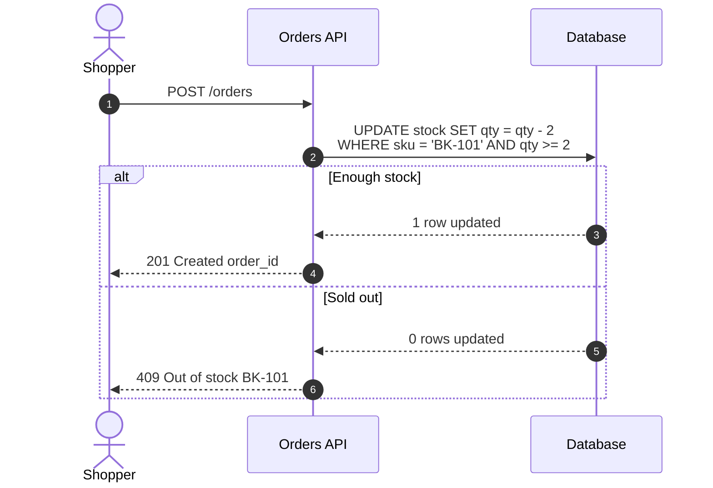

# Annotation spec `walkthrough/1`

Version 1 · 2026-10-28 · read by the Sequence Walkthrough Viewer v1 and `validate.py`

Walkthrough annotations turn a Mermaid sequence diagram into a guided, step-by-step explanation. Every annotation is a Mermaid comment (`%% …`), so annotated code still renders unchanged on mermaid.live, GitHub, GitLab, Notion and any other Mermaid renderer. Only the viewer gives the comments meaning.

## Contents

1. Shape of a file
2. Tags
3. Rules
4. How steps are identified
5. Lint
6. Mermaid syntax traps
7. Fallbacks
8. Complete example

## 1. Shape of a file

```
sequenceDiagram                      ← diagram type (front matter and %% comments may come first)
    %% @spec walkthrough/1           ← header block: spec, title, one @layer per participant
    %% @title <flow name>
    %% @layer <alias> <description>
    autonumber                       ← optional, recommended
    actor U as User                  ← participants, in left-to-right order
    participant API as Orders API

    %% @section <chapter name>       ← optional chapters
    %% @step <what happens and why>  ← annotations for the next arrow
    %% @payload <example data>
    %% @ref <path:line or URL>
    U->>API: POST /orders            ← the arrow they belong to
```

Indentation is free. Blank lines are ignored.

## 2. Tags

| Tag | Where | Value | Shown in the viewer as |
|---|---|---|---|
| `%% @spec walkthrough/1` | right after `sequenceDiagram` | format version | not shown; marks the file |
| `%% @title <text>` | header block | the flow's name | top-left name, file names of every export |
| `%% @layer <alias> <text>` | header block, one per participant | what the layer is and does in this flow | tooltip on the participant in the header, layer list |
| `%% @section <name>` | above the first arrow of a chapter | chapter name | chapter row, chapter progress ("2 of 5 in Retries"), table chapter column |
| `%% @step <text>` | directly above an arrow | what happens and why | the centre card's explanation, the table's "Does" column |
| `%% @payload <text>` | above an arrow | example data sent | expandable payload box on the card |
| `%% @ref <file:line or URL>` | above an arrow | where the step lives in the code | source chip on the card, table "Ref" column |

Tag names are case-insensitive (`@Step` works), but lower case is the convention.

## 3. Rules

1. **One annotation per line**, starting with `%% @` after optional indentation. `%%@step` and `%%   @step` also work.
2. **`@step`, `@payload` and `@ref` attach to the next arrow**, even if a block keyword (`alt`, `else`, `loop`, `opt`, `par`, `rect`, `end`), a `Note`, `activate` or a participant line sits between them and the arrow.
3. **Several lines of the same tag are joined.** `@step` lines are joined with a space, `@payload` lines with a line break, and each `@ref` line adds a reference.
4. **`@section` starts a chapter at the next arrow** and applies to every arrow until the next `@section`. Arrows before the first `@section` belong to an unnamed opening chapter, shown as **Start**.
5. **`@title`, `@spec` and `@layer` can be anywhere**, but belong in the header block. If a tag appears twice, the last one wins.
6. **Never write `%%{`.** Mermaid reserves `%%{ … }%%` for configuration. It is not an annotation.
7. **Plain comments are fine.** A `%%` line without `@` is ignored by the viewer.
8. **Notes and bookmarks are never stored in the code.** They are personal and stay in the viewer.

### Title precedence

The flow name is the first of: `@title`, the front-matter `title:`, Mermaid's `title` keyword, and finally "Sequence diagram". File names use the flow name with `\ / : * ? " < > |` removed, so `@title Payment idempotency` exports as `Payment idempotency.pdf`, `Payment idempotency.mmd` and so on.

## 4. How steps are identified

Steps are numbered in drawing order, the same order as Mermaid's `autonumber`. Personal notes and bookmarks are matched to a step by **sender → receiver | label**, plus an occurrence count when the same arrow appears twice. As a result:

- editing `@step`, `@payload`, `@ref`, `@section` or `@layer` text never detaches a note;
- adding or removing other arrows never detaches a note (unless the added arrow is an exact copy of an existing one);
- changing an arrow's sender, receiver or label moves its notes to **Notes for changed steps**, where they can be re-attached.

Tools that update walkthrough code should keep arrow lines unchanged unless asked to change them.

## 5. Lint

The viewer lists these in the code panel, and `validate.py` reports them as **warnings** with the same codes, messages and line numbers:

| Code | When | Message |
|---|---|---|
| `no-step` | an arrow has no `@step` above it | Step N (From → To) has no @step |
| `orphan` | `@step`, `@payload` or `@ref` with no arrow after it | Annotation has no arrow after it |
| `unknown-alias` | a `@layer` alias is not a participant | @layer X: no participant has this alias |
| `layer-empty` | `@layer` with nothing after it | @layer needs an alias and a description |
| `long-step` | a step's joined `@step` text is over 240 characters | Step N: @step is N characters (keep it under 240) |
| `empty-section` | a `@section` with no arrow before the next `@section` or the end, or with no name | Chapter "X" has no steps |
| `no-title` | no `@title` | Add %% @title <flow name> so the flow has a name |
| `unknown-tag` | `%% @something` that is not one of the seven tags | Unknown tag @x (known: …) |

The viewer adds `mismatch` when Mermaid draws a different number of arrows than the code lines it found (for example, an arrow hidden inside an unsupported construct).

`validate.py` adds:

| Severity | Code | When |
|---|---|---|
| error | `semicolon`, `no-colon`, `unknown-line`, `block`, `keyword-alias`, `not-sequence` | Mermaid 12 will not parse the code (see section 6) |
| warning | `hash-cut` | a label contains `#`, so Mermaid drops the rest of it |
| warning | `no-arrows` | a sequence diagram with no arrows |
| hint | `spec` | `@spec walkthrough/1` is missing or different |
| hint | `layer-missing` | a participant has no `@layer` |
| hint | `no-sections` | more than 8 steps and no `@section` |
| hint | `many-refs` | a step with more than 2 `@ref` lines |
| hint | `config` | a `%%{ … }%%` line |
| hint | `inline-comment` | `%%` inside a statement line, which Mermaid keeps as label text |
| hint | `request-payload` | a `POST`, `PUT` or `PATCH` request with no `@payload` |
| hint | `no-reply` | an HTTP request (`->>` with a method and path) with no dashed reply back to its caller |
| hint | `reply-status` | a reply to an HTTP request whose label doesn't start with a status code |
| hint | `reply-payload` | a 2xx reply (except 204) to an HTTP request with no `@payload` |
| hint | `no-ref` | a step with no `@ref`, sent by a layer whose other steps have one (people are exempt) |

`validate.py -` reads the code from stdin, so a diagram can be checked without saving it to a file.

## 6. Mermaid syntax traps

These were each checked against Mermaid 12.2.0:

| Write | Mermaid does | Instead |
|---|---|---|
| `A->>B: retry; wait` | parse error: `;` ends the statement | a comma, or `#59;` |
| `A->>B: close issue #42` | draws `close issue`: the rest is dropped | `#35;42`, or `issue 42` |
| `A->>B` (no colon) | parse error | `A->>B: ` (an empty label is fine) |
| `alt` … with no `end` | parse error | close every `alt`, `opt`, `loop`, `par`, `critical`, `break`, `rect` and `box` |
| `else` outside `alt` | parse error | `else` only inside `alt`, `and` only inside `par`, `option` only inside `critical` |
| `participant end` | parse error | never use a keyword as an alias |
| `A->>B: hi %% note` | draws `hi %% note` | put comments on their own line |

`<br/>` splits a label over two lines. Quotes, braces, `<`, `>`, `%` and `:` after the first colon are all safe in labels.

## 7. Fallbacks

| Case | Viewer behaviour |
|---|---|
| Arrow without `@step` | The card shows the label and sender → receiver; lint suggests a `@step` |
| No annotations at all | Works like mermaid.live, plus the walkthrough bar showing labels |
| No `@section` | No chapter row; everything else is unchanged |
| No `@title` | Flow name "Sequence diagram"; lint suggests adding one |
| Not a sequence diagram | Renders with pan and zoom; walkthrough, sticky header and table switch off, with a one-line notice |
| `@spec` missing or different | Read as `walkthrough/1` |

## 8. Complete example


